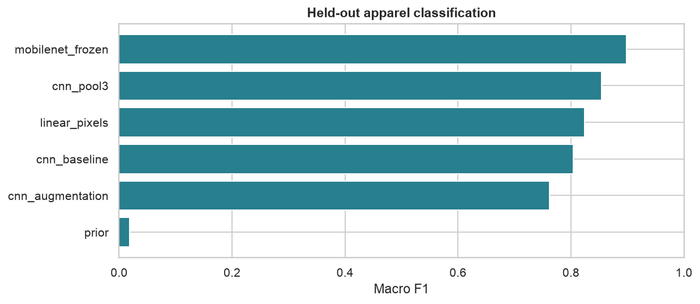

# ShelfSight | Apparel Catalog Vision

[](https://github.com/Pariamazaheri/shelfsight-apparel-vision/actions)

**Make apparel classification measurable, explainable and reproducible.** ShelfSight compares a compact custom CNN with frozen pretrained visual features, audits category confusion and model confidence, and packages local image inference.

The project uses [Kaggle Fashion-MNIST](https://www.kaggle.com/datasets/zalando-research/fashionmnist), the established [Zalando apparel benchmark](https://github.com/zalandoresearch/fashion-mnist). It demonstrates a catalog-classification workflow using ten apparel categories, with explicit data isolation, a bounded training budget and auditable predictions. Its grayscale thumbnails are a benchmark representation; performance on live product photography is unmeasured.



## Results and business implications

The full official **10,000-image test set** is retained. Development uses 12,000 training and 3,000 validation images sampled from the original training pool.

| Model | Test accuracy | Macro F1 | Probability log loss |
|---|---:|---:|---:|
| Frozen MobileNetV3-Small + linear head | **89.83%** | **0.8983** | **0.312** |
| Selected custom CNN | 85.62% | 0.8541 | 0.391 |
| Linear pixel reference | 82.59% | 0.8239 | 3.052 |
| Base CNN | 80.88% | 0.8044 | 0.494 |
| Base CNN + augmentation | 77.20% | 0.7623 | 0.567 |
| Class-prior reference | 10.00% | 0.0182 | 2.303 |

- **Transfer features improve recognition under this budget.** MobileNet macro F1 has a pixel-cluster bootstrap interval of approximately **[0.893, 0.904]**. This is a single-seed comparison, not a state-of-the-art claim.
- **Category errors matter more than one headline score.** The custom CNN identifies trousers with 98.0% recall, but shirts with only 54.2%; similar garment silhouettes need closer review.
- **Confidence needs its own audit.** The linear reference's accuracy hides weak probability quality. Confident errors remain even in the selected CNN, despite low aggregate calibration error.
- **Augmentation needs domain and budget validation.** Flips, small rotations and crops reduce performance in this eight-epoch recipe. That result should prompt a targeted follow-up, not a claim that augmentation never helps.

[Complete scores](reports/test_metrics.csv) · [Per-image probabilities](reports/test_predictions.csv) · [Category metrics](reports/category_metrics.csv) · [Experiment findings](reports/experiment_findings.md)

## Methodology

1. Validate source labels/pixels; hash image content to isolate exact duplicates. Exclude **10 development images matching test pixels** and audit **43 duplicate development images** before sampling.
2. Fit custom-CNN normalization only on training images; keep validation/test augmentation disabled.
3. Compare **nine CNN configurations** covering kernel size, stride, filter count, pooling type/window, depth and augmentation. Record parameter counts, loss curves and CPU time.
4. Select the custom architecture on validation macro F1. Evaluate its locked configuration and predeclared references on the held-out set.
5. Freeze every pretrained MobileNetV3-Small feature layer and fit a training-only linear head on 576-dimensional embeddings, using official ImageNet preprocessing.
6. Report accuracy, macro F1, probability log loss, calibration, category confusion, uncertainty intervals and a confident-error gallery.

Near duplicates remain possible. Transfer runtime includes feature extraction for all splits; custom-CNN runtime includes training/validation only. These are different scopes. The linear reference reached its fixed iteration limit. See [methodology](docs/methodology.md), [reproduction](docs/reproduction.md) and [industry model strategy](docs/industry_model_strategy.md).

## Installation

```bash
git clone https://github.com/Pariamazaheri/shelfsight-apparel-vision.git
cd shelfsight-apparel-vision
python3.12 -m venv .venv
source .venv/bin/activate
python -m pip install '.[dev]'
```

Python 3.11/3.12 are supported. [Recorded versions](requirements-lock.txt) reproduce the published direct dependencies. The data and pretrained checkpoint are downloaded by the training command; no Kaggle token is required.

## Usage

```bash
# Download, train, compare architectures and regenerate reports.
shelfsight run

# Run the locally trained custom CNN on a supplied benchmark thumbnail.
shelfsight predict --input data/example_apparel.png --output reports/example_prediction.json

# Execute the artifact-based notebook and independently audit scores.
python scripts/execute_notebook.py
python scripts/validate_results.py
pytest -q
ruff check .
```

The image command requires a **28-by-28 grayscale** image and the locally trained custom checkpoint; it is not a general product-photo API. Transfer is an evaluation reference. Open the [executed notebook](notebooks/apparel_vision.ipynb) or committed [findings](reports/experiment_findings.md) without training. `--root` supports execution outside the repository directory.

## Repository map

| Directory | Contents |
|---|---|
| `src/shelfsight/` | Data validation, transforms, CNNs, transfer features, training, metrics, plots and inference |
| `data/` | Source metadata, retained dataset license and one example image |
| `notebooks/` | Executed analysis and error inspection |
| `reports/` | Predictions, metrics, split hashes, experiment findings and eight figures |
| `docs/` | Modeling decisions, reproduction contract and retail model strategy |
| `scripts/` | Notebook execution and independent artifact validation |
| `tests/` | Image schema, augmentation boundaries, model variants and inference contracts |

CI verifies code and published evidence without downloading data/weights or retraining. Raw data, checkpoints and environment files are ignored. Tracked directories contain useful artifacts, with no placeholder folders.

## License and scope

Code: MIT. Original Fashion-MNIST: MIT, copyright Zalando SE; the Kaggle mirror lists “Other” and links upstream. See [data provenance and retained license](data/README.md). This is an independent benchmark and inference prototype, with no claim of employer experience, live catalog deployment or commercial impact.
